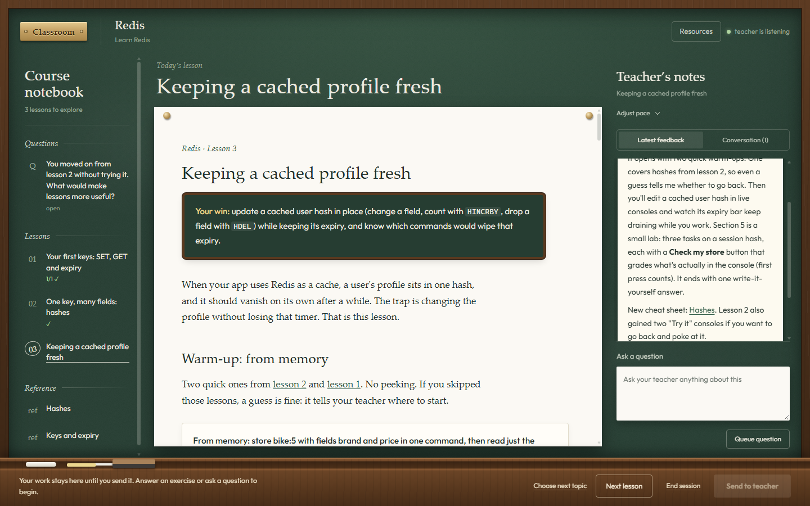

# interactive-teaching

An agent skill that teaches you a topic over many sessions in a browser classroom. It uses the pedagogy of
Matt Pocock's [`teach`](https://github.com/mattpocock/skills) skill: a mission, short lessons in your zone of proximal development, and retrieval practice. Instead of the
terminal, it runs in a local page that looks like a chalkboard.



## How it works

- **Lessons** open in the middle of the page. Each one has a single goal, cites its sources, and ends with you
  producing the skill unaided.
- **Quizzes are graded instantly in the page.** Wrong answers explain the specific mistake. Only your first
  attempt counts.
- **Your answers, quiz results and questions queue up** until you press **Send to teacher**. Your agent then reads
  them as evidence, replies in the side panel, keeps learning records, and writes the next lesson from what you
  actually got right and wrong.
- **Everything lives in a folder you own:** `MISSION.md`, lessons, printable reference sheets, learning
  records, and a ledger of verified facts.

## Requirements

- [Node.js](https://nodejs.org) 18 or newer, which runs the classroom server (`teach.mjs`).
- A coding agent that can run shell commands and read and write files.

It's written as an [Agent Skills](https://agentskills.io) folder (a `SKILL.md` with instructions, plus
supporting files). That's an open standard supported by many agents, including Claude Code, Codex, Gemini CLI,
Cursor, GitHub Copilot and OpenCode, so the skill isn't tied to one tool. It has been tested only with
[Claude Code](https://claude.com/claude-code) so far.

## Install and use with Claude Code

Clone into your skills folder:

```sh
git clone https://github.com/pratham124/interactive-teaching ~/.claude/skills/interactive-teaching
```

On Windows, the folder is `%USERPROFILE%\.claude\skills\interactive-teaching`.

Make an empty folder for the topic, open Claude Code in it, and run:

```
/interactive-teaching I'd like to learn Redis
```

The agent asks a few questions about why you're learning, starts the classroom, and opens it in your browser.
Press **Next lesson** to continue and **End session** to stop. To pick up later, open Claude Code in the same
folder and run:

```
/interactive-teaching resume
```

## Use with other agents (untested)

1. Clone the repo wherever your agent loads skills from. If it doesn't support skills, clone it anywhere and
   point the agent at `SKILL.md`, for example: "Read `<path>/SKILL.md` and follow it to teach me Redis."
2. Open the agent in an empty folder for the topic. That folder becomes the teaching workspace.
3. Every command in `SKILL.md` has the form `node $SKILL/teach.mjs …`, where `$SKILL` is the folder you
   cloned. Tell the agent that path if it can't work it out.

Two Claude Code features are optional:

- **Listening for your Sends.** Claude Code watches the classroom with a background monitor. An agent without
  one follows the **Wait mode** section of `SKILL.md`, which blocks on `teach.mjs wait` until your next
  Send.
- **Subagents.** Claude Code can hand lesson drafting to a subagent. Other agents just write the lesson
  themselves.

## What's inside

| Path | What it is |
|---|---|
| `SKILL.md` | The skill: Part 1 is the teaching method, Part 2 is the classroom mechanics |
| `lesson-brief.md` | The brief given to whoever writes a lesson |
| `*-FORMAT.md` | Formats for the mission, resources, learning records and glossary |
| `teach.mjs` | The classroom server and CLI (`init`, `serve`, `say`, `lesson`, `check-lesson`, …) |
| `page.html` | The classroom page |
| `kit/` | Starter components copied into each workspace: stylesheet, quiz kit, font |
| `test/` | Tests: `node --test test/teach.test.mjs` |
| `evals/` | Evaluation prompts for the skill |

## Credits

Built on the [`teach`](https://github.com/mattpocock/skills) skill by Matt Pocock (MIT), with the
classroom idea inspired by [grill-with-ui](https://github.com/jasonku09/grill-with-ui). Third-party notices
are in [NOTICE.md](NOTICE.md).

## Licence

[MIT](LICENSE).
